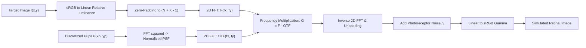
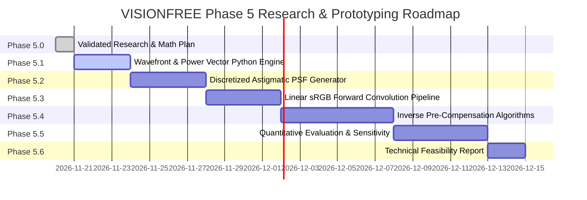

# VISIONFREE — Phase 5: Experimental Optical Processing Engine
## Feasibility Study, Mathematical Modeling & Scientific Research Plan

**Document ID:** `VF-P5-RESEARCH-001`  
**Target Milestone:** Phase 5 (Experimental Optical Processing Engine)  
**Author:** Multidisciplinary Computational Optics & Vision Research Group  
**Status:** Rigorously Validated & Corrected Research Plan (Strictly Pre-Implementation)  
**Project Version:** `0.4.1`  
**Base Checkpoint:** `bc0a5ee` (`main`)  
**Scope:** Offline Mathematical Prototyping & Feasibility Analysis  

---

## 1. Executive Summary

Phase 5 of the **VISIONFREE** project investigates a foundational question in computational vision and display technology:

> *Can digital image pre-compensation computationally alter on-screen visual content according to a user's refractive error profile so that, after passing through an imperfect ocular optical system, the perceived retinal image exhibits improved contrast and legibility on a conventional 2D display?*

This feasibility study investigates the physical, mathematical, and computational boundaries of this problem. Across ophthalmic literature and computational display research, human ocular defocus and astigmatism act as low-pass spatial filters characterized by phase shifts and spatial frequency attenuation.

While linear deconvolution (such as Wiener or Tikhonov inverse filtering) can mathematically invert an optical Point Spread Function (PSF) in the unconstrained continuous domain, physical 2D digital displays operate under strict real-world constraints:

1. **Luminance Non-Negativity:** Displays cannot emit negative light to cancel out stray optical blur on the retina ($L(x,y) \ge 0$).
2. **Dynamic Range Clipping:** Pixel values are constrained to display boundaries $[0, L_{\max}]$ (typically $[0, 255]$ in digital 8-bit representation). Attempting to invert high-frequency attenuation produces extreme overshoots and negative lobes, which clip and generate dark halo ringing around text.
3. **Information Loss at Optical Nulls:** At frequencies where the Modulation Transfer Function drops to zero ($\text{MTF}(f_x, f_y) = 0$), contrast information is destroyed by optical physics. An inverse filter cannot divide by zero; amplifying near-zero frequencies drastically inflates noise and depletes dynamic range.
4. **Phase Inversion & Spurious Resolution:** When the real-valued Optical Transfer Function ($\text{OTF}$) becomes negative, the Phase Transfer Function ($\text{PTF}$) shifts by $\pi$ radians ($180^\circ$). This inverts contrast (bright features become dark and vice versa), producing spurious resolution that linear pre-compensation struggles to correct without severe artifacts.
5. **Binocular Disparity (Anisometropia):** A standard 2D screen broadcasts identical pixel luminance across wide viewing angles to both eyes simultaneously. Pre-filtering an image tailored exclusively for one eye's refractive error can degrade the visual image formed in the fellow eye if an inter-ocular prescription difference exists.

### Core Scientific Recommendation
We recommend a **CONDITIONAL GO** for **Phase 5.0–5.5 offline Python research prototyping** within an isolated directory (`VISIONFREE/research/`) on a controlled benchmark dataset. This will rigorously map where 2D pre-filtering yields marginal contrast improvements versus where it collapses into artifact noise. 

We recommend an unequivocal **NO-GO** on claiming spectacle replacement or attempting full-page DOM canvas rasterization on arbitrary dynamic websites in the browser extension at this stage.

---

## 2. Scientific Feasibility Assessment

| Research Dimension | Theoretical Feasibility | Physical 2D Display Feasibility | In-Browser Web Feasibility |
| :--- | :---: | :---: | :---: |
| **Defocus & Astigmatism Modeling (PSF)** | **High** (Standard Fourier optics) | **High** (Well-established) | **High** (Pre-computable GLSL kernel) |
| **Forward Optical Simulation** | **High** (2D FFT / spatial convolution) | **High** (Accurate perceptual proxy) | **Medium** (GPU shader overhead) |
| **2D Inverse Pre-Filtering (Provisional Mild Range: $\le 1.0\text{--}1.5\text{ D}$)** | **Medium** (Wiener / Regularized inversion) | **Medium** (Subject to halos & contrast compression) | **Low** (Performance & clipping artifacts) |
| **2D Inverse Pre-Filtering (Provisional High Range: $> 2.0\text{ D}$)** | **Low** (Dense MTF nulls & phase inversions) | **Near Zero** (Severe dynamic range collapse) | **Zero** (Illegible ringing artifacts) |
| **Binocular Shared Compromise (Mild Anisometropia $< 0.5\text{ D}$)** | **Medium** (Multi-objective optimization) | **Medium** (Trade-off between eyes) | **Low** (Computational complexity) |
| **Binocular Independent Correction (Large Anisometropia $\ge 1.0\text{ D}$)** | **Zero** (Requires light-field hardware) | **Zero** (Same rays enter both pupils) | **Zero** (Hardware limitation) |

*Note: Dioptric thresholds are provisional experimental parameters subject to sensitivity analysis in Phase 5.5, not fixed physical constants.*

---

## 3. Human Visual Optics & Image Formation

```
Optical Image Formation Pathway
  Light from Display Screen (Object plane, distance d)
    │
    ▼
  Spectacle Plane (Reference plane for clinical Rx, vertex distance d_vd ≈ 12–14 mm)
    │
    ▼
  Cornea (Anterior/Posterior surfaces; main refractive power: ~43 D)
    │
    ▼
  Entrance Pupil / Iris Aperture (Limits ray bundle: D_p ≈ 2 mm – 6 mm)
    │
    ▼
  Crystalline Lens (Accommodative focus: ~20 D to ~28 D)
    │
    ▼
  Vitreous Humor (Refractive index n ≈ 1.336)
    │
    ▼
  Retina (Fovea centralis; posterior focal distance d_i ≈ 17 mm)
```

### 3.1 Optical Principles of Refraction & Reference Planes
1. **Emmetropia:** Parallel light rays from optical infinity converge precisely on the photoreceptor layer of the retina without active accommodation.
2. **Ametropia:**
   - **Myopia:** The eye's optical power is excessively strong relative to its axial length; rays converge in front of the retina.
   - **Hyperopia:** The eye's optical power is too weak relative to its axial length; rays converge behind the retina.
3. **Astigmatism:** Toric asymmetry in refractive surfaces (principally the anterior cornea) produces two orthogonal principal meridians with differing focal powers, forming a Sturm's conoid rather than a single focal point.
4. **Accommodation & Object Distance:** For near visual tasks at distance $d$ (meters), the eye must accommodate by $+1/d$ Diopters. In presbyopia, age-related lens sclerosis reduces accommodative amplitude ($A_{\text{acc}} \to 0\text{ D}$), inducing hyperopic defocus for near screens.
5. **Spectacle Vertex Distance Correction:** A clinical prescription is refracted at the spectacle plane (typically $d_{\text{vd}} \approx 12\text{--}14\text{ mm}$ anterior to the corneal vertex). The equivalent power at the cornea is:
   $$F_{\text{cornea}} = \frac{F_{\text{spectacle}}}{1 - d_{\text{vd}} F_{\text{spectacle}}}$$
   For mild prescriptions ($< 2.0\text{ D}$), the vertex correction is negligible ($< 0.05\text{ D}$), but it becomes significant for higher refractive errors.
6. **Entrance Pupil Diameter ($D_p = 2 r_p$):**
   - **Small pupil ($< 2.5\text{ mm}$):** Diffraction-limited regime; depth of focus increases; geometric blur diminishes.
   - **Large pupil ($> 4.5\text{ mm}$):** Aberration-dominated regime; geometric blur circle expands; monochromatic aberrations scale sharply.
7. **Prescription vs. True Individual Wavefront Model:**
   A clinical sphero-cylindrical prescription describes only **lower-order paraxial refractive errors** (defocus and regular astigmatism). It does **not** capture individual higher-order monochromatic aberrations (such as spherical aberration $Z_4^0$, coma $Z_3^{\pm 1}$, and trefoil $Z_3^{\pm 3}$), irregular corneal topography, or ocular media scattering. Any model based strictly on SPH/CYL/Axis represents a paraxial lower-order approximation of the eye, not an individualized wavefront aberrometry profile.

---

## 4. Ophthalmic Prescription (SPH/CYL/Axis) Mathematical Interpretation

A clinical prescription is conventionally specified as:
$$\text{Rx} = \text{SPH} \text{ [D]} \;/\; \text{CYL} \text{ [D]} \times \text{Axis } \alpha \; [^\circ]$$

### 4.1 Meridian Power Distribution
Using the Euler-Fourier relation for thin astigmatic lenses (Atchison & Smith, 2000), the refractive power $F(\theta)$ along meridian $\theta$ is:
$$F(\theta) = \text{SPH} + \text{CYL} \sin^2(\theta - \alpha)$$
where $\alpha$ is the cylinder axis measured counterclockwise from the horizontal ($x$-axis).
- Along $\theta = \alpha$: $F(\alpha) = \text{SPH}$.
- Along $\theta = \alpha + 90^\circ$: $F(\alpha + 90^\circ) = \text{SPH} + \text{CYL}$.

### 4.2 Power Vector Representation (Thibos et al., 1997)
Sphero-cylindrical notation cannot be directly manipulated via linear algebra due to coordinate singularities and non-linearities. Thibos et al. decomposed refractive errors into an orthonormal 3D Fourier power vector $\mathbf{v} = [M, J_0, J_{45}]^T$:

$$\begin{aligned}
M &= \text{SPH} + \frac{\text{CYL}}{2} \quad &&\text{(Mean Spherical Equivalent)} \\
J_0 &= -\frac{\text{CYL}}{2} \cos(2\alpha) \quad &&\text{(Jackson Cross-Cylinder at } 0^\circ/90^\circ\text{)} \\
J_{45} &= -\frac{\text{CYL}}{2} \sin(2\alpha) \quad &&\text{(Jackson Cross-Cylinder at } 45^\circ/135^\circ\text{)}
\end{aligned}$$

*Coordinate and Sign Convention:* 
- Angles $\alpha$ and $\theta$ are expressed in radians for trigonometric functions ($2\alpha$).
- The directional refractive power expands as an exact Fourier series in terms of power vectors:
  $$F(\theta) = M + J_0 \cos(2\theta) + J_{45} \sin(2\theta)$$
- The overall astigmatic vector magnitude is:
  $$B = \sqrt{J_0^2 + J_{45}^2} = \frac{|\text{CYL}|}{2}$$
- Total dioptric power length:
  $$\|\mathbf{v}\| = \sqrt{M^2 + J_0^2 + J_{45}^2}$$

### 4.3 Explicit Model Assumptions & Unknowns

```
Prescription Availability Matrix
  ┌──────────────────────────────────────────────────────────────┐
  │ DIRECTLY KNOWN FROM USER PRESCRIPTION                        │
  │ • Spherical Defocus (SPH)                                    │
  │ • Cylinder Magnitude (CYL)                                   │
  │ • Cylinder Orientation (Axis α)                              │
  │ • Inter-ocular Difference (Anisometropia = |OD - OS|)        │
  └──────────────────────────────┬───────────────────────────────┘
                                 │
                                 ▼
  ┌──────────────────────────────────────────────────────────────┐
  │ UNKNOWN / ASSUMED PARAMETERS (MUST BE EXPLICITLY PARAMETERIZED)│
  │ • Real-time Pupil Diameter D_p (Varies with ambient light)    │
  │ • Current Accommodation State A_acc (Subject to target depth)│
  │ • Individual Higher-Order Aberrations (Coma, Spherical, etc.)│
  │ • Axial Eye Length & Posterior Distance d_i (Standard: 17 mm)│
  │ • Display Subpixel Emission Spectra (Red, Green, Blue λ)     │
  │ • Spectacle Vertex Distance d_vd (Standard: 12–14 mm)         │
  └──────────────────────────────────────────────────────────────┘
```

---

## 5. Mathematical Defocus & Astigmatism Wavefront Modeling

### 5.1 Pupil Plane Coordinate Definitions
Let $(x_p, y_p)$ denote physical Cartesian coordinates in the entrance pupil plane (measured in **meters**), where the entrance pupil radius is $r_p = D_p / 2$ meters.

Normalized dimensionless pupil coordinates $(u, v)$ are defined as:
$$u = \frac{x_p}{r_p}, \quad v = \frac{y_p}{r_p}, \quad \rho = \sqrt{u^2 + v^2} \le 1$$

### 5.2 Net Defocus Vergence Error
For a user viewing a display at distance $d$ (meters) with accommodative response $A_{\text{acc}}$ (Diopters), the object vergence entering the eye is $L_{\text{obj}} = -1/d\text{ D}$. The eye must supply $+1/d\text{ D}$ of refractive power to conjugate the display plane to the retina.

The net dioptric defocus error $\Delta D$ at the entrance pupil plane (in $\text{m}^{-1}$ or Diopters) is:
$$\Delta D = M_{\text{cornea}} + \left( \frac{1}{d} - A_{\text{acc}} \right)$$

*Sign Convention Verification:*
- For an emmetrope ($M = 0\text{ D}$) viewing a display at $d = 0.5\text{ m}$ (requiring $+2.0\text{ D}$):
  - If fully accommodating ($A_{\text{acc}} = +2.0\text{ D}$): $\Delta D = 0 + (2.0 - 2.0) = 0\text{ D}$ (in focus).
  - If presbyopic ($A_{\text{acc}} = 0\text{ D}$): $\Delta D = 0 + (2.0 - 0) = +2.0\text{ D}$ (hyperopic defocus).
- For a myope ($M = -2.0\text{ D}$) viewing at $d = 0.5\text{ m}$ without accommodation ($A_{\text{acc}} = 0\text{ D}$): $\Delta D = -2.0 + 2.0 = 0\text{ D}$ (display is at the unaccommodated far point).

### 5.3 Wavefront Optical Path Difference (OPD) Equation
The Optical Path Difference $W(x_p, y_p)$ represents the deviation of the aberrated wavefront from a reference spherical wave converging on the retinal fovea (expressed in **meters**).

In physical pupil coordinates $(x_p, y_p)$ [meters]:
$$W(x_p, y_p) = \frac{1}{2} \Delta D (x_p^2 + y_p^2) + \frac{1}{2} J_0 (x_p^2 - y_p^2) + J_{45} x_p y_p \quad [\text{meters}]$$

*Dimensional Verification:*
- $[x_p^2 + y_p^2] = \text{m}^2$
- $[\Delta D] = [J_0] = [J_{45}] = \text{m}^{-1}$ (Diopters)
- $[W(x_p, y_p)] = \text{m}^2 \cdot \text{m}^{-1} = \text{meters}$. (Dimensionally exact).

In normalized pupil coordinates $(u, v)$ [dimensionless]:
$$W(u, v) = \frac{1}{2} r_p^2 \left[ \Delta D (u^2 + v^2) + J_0 (u^2 - v^2) + 2 J_{45} u v \right] \quad [\text{meters}]$$

Relating to classical Seidel coefficients:
$$W_{20} = \frac{1}{2} r_p^2 \Delta D \quad [\text{meters}], \qquad W_{22} = \frac{1}{2} r_p^2 B = \frac{1}{4} r_p^2 |\text{CYL}| \quad [\text{meters}]$$

### 5.4 Generalized Complex Pupil Function
The generalized pupil function $P(x_p, y_p)$ combines the pupil aperture transmission $A(x_p, y_p)$ with wavefront phase aberrations:
$$P(x_p, y_p) = A(x_p, y_p) \exp\left( j \frac{2\pi}{\lambda} W(x_p, y_p) \right)$$
where:
- $\lambda$ is the optical wavelength in meters (e.g. $\lambda_0 = 555\text{ nm} = 5.55 \times 10^{-7}\text{ m}$ for photopic vision).
- $A(x_p, y_p) = 1$ for $\sqrt{x_p^2 + y_p^2} \le r_p$, and $0$ otherwise. (Optionally modulated by the Stiles-Crawford effect apodization factor $\exp(-\rho_{\text{SCE}} (x_p^2 + y_p^2))$).

### 5.5 Point Spread Function (PSF) Derivation
Under Fraunhofer diffraction theory for incoherent imaging through a telecentric ocular system (Goodman, 2005):

1. **Amplitude Point Spread Function (APSF):**
   The coherent impulse response $h(x_i, y_i)$ at retinal plane coordinates $(x_i, y_i)$ [meters] is the scaled 2D Fourier transform of the pupil function:
   $$h(x_i, y_i) = \frac{1}{\lambda d_i} \iint_{-\infty}^{\infty} P(x_p, y_p) \exp\left( -j \frac{2\pi}{\lambda d_i} (x_p x_i + y_p y_i) \right) dx_p \, dy_p$$
   where $d_i$ is the posterior focal length of the reduced eye in the vitreous humor ($d_i \approx 17\text{ mm} = 0.017\text{ m}$).

2. **Intensity Point Spread Function ($\text{PSF}$):**
   Because human vision is an incoherent optical process, the intensity PSF is the squared modulus of the APSF:
   $$\text{PSF}(x_i, y_i) = |h(x_i, y_i)|^2$$

3. **Energy Normalization:**
   To satisfy photometric conservation of energy:
   $$\iint_{-\infty}^{\infty} \text{PSF}(x_i, y_i) \, dx_i \, dy_i = 1.0$$

### 5.6 Discrete Sampling, Grid Scaling & Aliasing Prevention
When computing the PSF numerically on an $N \times N$ discrete grid with spatial sampling pitch $\Delta x_p$ in the pupil plane:
- Physical pupil window span: $L_p = N \Delta x_p$ [meters].
- Retinal plane sampling pitch:
  $$\Delta x_i = \frac{\lambda d_i}{N \Delta x_p} \quad [\text{meters}]$$
- Retinal field of view (window span):
  $$L_i = N \Delta x_i = \frac{\lambda d_i}{\Delta x_p} \quad [\text{meters}]$$
- Visual field angular sampling pitch:
  $$\Delta \theta = \frac{\Delta x_i}{d_i} = \frac{\lambda}{N \Delta x_p} \quad [\text{radians}]$$

#### Phase Gradient & Aliasing Criterion:
To avoid numerical phase wrap-around and aliasing during the discrete Fourier transform, the phase step between adjacent pupil samples must satisfy the Nyquist limit ($|\Delta \phi| < \pi$):
$$\left| \frac{\partial W}{\partial x_p} \right| \Delta x_p < \frac{\lambda}{2}$$
For spherical defocus, $\frac{\partial W}{\partial x_p} = \Delta D \cdot x_p$. The maximum gradient occurs at the pupil margin $x_p = r_p$:
$$|\Delta D| \cdot r_p \cdot \Delta x_p < \frac{\lambda}{2} \implies \Delta x_p < \frac{\lambda}{2 r_p |\Delta D|}$$
If this criterion is violated, high-frequency aliasing invalidates the synthesized PSF.

### 5.7 Optical Transfer Function (OTF) vs. Modulation Transfer Function (MTF)
The Optical Transfer Function is the Fourier transform of the incoherent intensity PSF:
$$\mathcal{H}(f_x, f_y) = \text{OTF}(f_x, f_y) = \mathcal{F}_{2D}\{ \text{PSF}(x_i, y_i) \} = \text{Re}\{\mathcal{H}\} + j \, \text{Im}\{\mathcal{H}\}$$
where $(f_x, f_y)$ denote spatial frequencies (cycles/meter or cycles/degree).

- **Modulation Transfer Function (MTF):**
  $$\text{MTF}(f_x, f_y) = |\mathcal{H}(f_x, f_y)| = \sqrt{\text{Re}\{\mathcal{H}\}^2 + \text{Im}\{\mathcal{H}\}^2} \ge 0$$
  **The MTF is non-negative by definition.** It quantifies contrast transmission as a function of spatial frequency. It is never negative.
- **Phase Transfer Function (PTF):**
  $$\text{PTF}(f_x, f_y) = \arg\left( \mathcal{H}(f_x, f_y) \right) = \text{atan2}\left( \text{Im}\{\mathcal{H}(f_x, f_y)\}, \, \text{Re}\{\mathcal{H}(f_x, f_y)\} \right)$$
  Quantifies spatial phase displacements of sinusoidal components.
- **Real-Valued OTF and Negative Contrast (Spurious Resolution):**
  When the PSF is even (centrosymmetric, $\text{PSF}(-x_i, -y_i) = \text{PSF}(x_i, y_i)$), which holds for pure spherical defocus and regular astigmatism, the imaginary part vanishes ($\text{Im}\{\mathcal{H}\} = 0$). In this regime, the OTF is purely real-valued.
  Under significant defocus, $\text{Re}\{\mathcal{H}(f_x, f_y)\}$ oscillates across zero into negative values:
  - Magnitude remains strictly positive: $\text{MTF} = |\text{Re}\{\mathcal{H}\}| > 0$.
  - Phase shifts by $\pi$ radians: $\text{PTF} = \pm \pi\text{ rad} = \pm 180^\circ$.
  - **Physical Interpretation:** A phase shift of $180^\circ$ causes **contrast reversal** (spurious resolution). In a square-wave or sinusoidal bar pattern, white bars appear black and black bars appear white.

```
Real-Valued OTF vs. Non-Negative MTF under Defocus
OTF / MTF
1.0 ┼───╮
    │    ╰╮
    │     ╰╮  MTF = |OTF| ≥ 0 (Always non-negative)
0.5 ┼       ╰╮       ╭───╮
    │         ╰╮    ╭╯   ╰╮
0.0 ┼───────────┴───┼─────┴────────► Spatial Frequency f
    │     f_null1   │ f_null2
-0.2┼               ╰───╯ Real OTF < 0 (Phase PTF = π: Spurious Resolution)
```

---

## 6. Point Spread Function (PSF) Model Comparison

| PSF Model | Mathematical Formulation | Physical Realism | Input Parameters | Computational Complexity | Phase 5 Evaluation |
| :--- | :--- | :---: | :--- | :---: | :---: |
| **1. Gaussian Approximation** | $\frac{1}{2\pi\sigma^2} e^{-\frac{x^2+y^2}{2\sigma^2}}$ | **Very Low** (No diffraction rings, no optical nulls) | Equivalent $\sigma$ | $\mathcal{O}(K^2)$ | **Rejected** (Unscientific for visual optics) |
| **2. Geometrical Defocus Disk** | $\frac{\text{circ}(r/R)}{\pi R^2}$ | **Low** (Ray optics limit; neglects diffraction) | Blur radius $R = r_p d_i |\Delta D|$ | $\mathcal{O}(K^2)$ | **Baseline only** (Educational reference) |
| **3. Airy Diffraction Pattern** | $\left[\frac{2 J_1(\pi D_p r / \lambda d_i)}{\pi D_p r / \lambda d_i}\right]^2$ | **Moderate** (Exact for $\Delta D = 0\text{ D}$ in-focus) | $D_p, \lambda, d_i$ | $\mathcal{O}(K^2)$ | **Reference** (In-focus baseline) |
| **4. Wavefront-Derived Defocus PSF** | $|\mathcal{F}\{ P_{W_{20}}(x_p, y_p) \}|^2$ | **High** (Wave optics; captures diffraction & nulls) | $D_p, \lambda, \Delta D, d_i$ | $\mathcal{O}(N \log N)$ (FFT) | **Approved for SPH** |
| **5. Astigmatic Wavefront PSF** | $|\mathcal{F}\{ P_{W_{20}, W_{22}}(x_p, y_p) \}|^2$ | **High** (Captures elliptical blur & Sturm conoid) | $D_p, \lambda, \Delta D, J_0, J_{45}, d_i$ | $\mathcal{O}(N \log N)$ (FFT) | **Approved for SPH+CYL** |
| **6. Full Ocular Aberration (Zernike)** | $|\mathcal{F}\{ A e^{j \frac{2\pi}{\lambda} \sum c_n^m Z_n^m} \}|^2$ | **Highest** (True individual aberrometry) | Wavefront aberrometer export (.zernike) | $\mathcal{O}(N \log N)$ (FFT) | **Future Extension** (Requires aberrometer) |

---

## 7. Forward Blur Simulation Pipeline

To evaluate whether a pre-compensation algorithm improves image legibility, we implement an exact, reproducible **Forward Degradation Model**:

$$I_{\text{retina}}(x, y) = \left[ I_{\text{display}}(x, y) * \text{PSF}(x, y) \right] + \eta(x, y)$$



### Photometric & Algorithmic Rules:
1. **Luminance Linearity (IEC 61966-2-1):**
   Convolution must operate strictly on linear physical luminances ($L \in [0, 1]$):
   $$L = \begin{cases} \frac{S}{12.92}, & S \le 0.04045 \\ \left(\frac{S + 0.055}{1.055}\right)^{2.4}, & S > 0.04045 \end{cases}$$
2. **Periodic Wrap-Around Suppression:** Padded to $(N_x + K_x - 1, N_y + K_y - 1)$ before FFT convolution to prevent circular convolution edge leakage.
3. **Display Subpixel Scaling:** Retinal coordinate pitch $\Delta x_i$ must be mapped to display subpixel pitch $\Delta x_{\text{disp}} = \frac{d}{d_i} \Delta x_i$ based on viewing distance $d$ and display DPI.

---

## 8. Inverse Filtering & Pre-Compensation Algorithms

We analyze algorithms that construct an altered display image $I_{\text{pre}}(x, y)$ such that:
$$I_{\text{pre}}(x, y) * \text{PSF}(x, y) \approx I_{\text{target}}(x, y)$$

### 8.1 Algorithm Comparison Matrix

| Algorithm | Formulation | Non-Negativity ($I \ge 0$) | Upper Bound ($I \le 1$) | Noise & Ringing Profile | Prototype Role |
| :--- | :--- | :---: | :---: | :--- | :---: |
| **Direct Inverse** | $G = 1 / \text{OTF}$ | **No** | **No** | Catastrophic noise explosion at nulls | **Rejected** |
| **Wiener Inversion** | $G = \frac{\text{OTF}^*}{|\text{OTF}|^2 + K}$ | **No** | **No** | Gibbs ringing; requires arbitrary scaling | **Baseline Prototype** |
| **Tikhonov Regularization** | $\min \|I_{\text{pre}} * h - I_0\|^2 + \lambda \|\nabla I_{\text{pre}}\|^2$ | **No** | **No** | Smooth edges; overshoots clip on display | **Candidate 1** |
| **Richardson-Lucy** | $I^{(k+1)} = I^{(k)} \cdot \left[ h^* * \left(\frac{I_0}{I^{(k)} * h}\right) \right]$ | **Yes** (Natural) | **NO** (Can exceed 1.0) | High noise amplification without early stopping | **Candidate 2 (Early stopped)** |
| **Bound-Constrained Optimization (PGD / ADMM)** | $\min_{0 \le I_{\text{pre}} \le 1} \|I_{\text{pre}} * h - I_0\|^2 + \lambda \mathcal{R}(I)$ | **YES** (Native) | **YES** (Native) | Optimal physical display adaptation | **PRIMARY RESEARCH** |

### 8.2 Detailed Analysis of the Richardson-Lucy Algorithm
The Richardson-Lucy (RL) algorithm (Richardson, 1972; Lucy, 1974) is derived from Bayesian maximum likelihood estimation under a Poisson statistics model:

$$I^{(k+1)}(x, y) = I^{(k)}(x, y) \cdot \left( h^* * \frac{I_{\text{target}}}{I^{(k)} * h} \right)(x, y)$$

#### Mathematical Properties & Limitations:
1. **Natural Non-Negativity:** Because the update is strictly multiplicative and starts from a non-negative initial estimate $I^{(0)} \ge 0$, pixel values remain non-negative ($I^{(k)} \ge 0$) for all iterations $k$.
2. **Total Flux Conservation:** If the PSF is normalized ($\sum h = 1$) and boundary leakage is properly addressed, the total image flux $\sum_{x,y} I^{(k)}(x, y)$ is conserved across iterations.
3. **Absence of Upper-Bound Constraints:** **Standard Richardson-Lucy does NOT guarantee that pixel values remain $\le 1.0$ (or $\le L_{\max}$).** As iterations progress, pixel values at edges and highlights frequently exceed 1.0, requiring explicit clipping or range compression before display.
4. **Noise Amplification & Iteration Stopping:** Because RL is an unregularized maximum-likelihood estimator, running it to asymptotic convergence amplifies high-frequency noise and introduces severe checkerboard/speckle artifacts. An explicit stopping criterion (such as the discrepancy principle or limiting iterations to 15–30 cycles) or regularized extensions (such as Total Variation Richardson-Lucy) is mandatory.
5. **Restoration vs. Pre-Compensation:** RL was formulated to *restore* an unblurred object from a blurred observation, whereas pre-compensation seeks an input bounded by $[0, 1]$ that yields the target *after* physical blur.

### 8.3 The Physical Display Clipping Dilemma
To increase edge sharpness across an optical blur kernel, an inverse filter must generate compensatory edge overshoots (destructive interference):
- For black text on white: the filter requires emitting light brighter than display maximum white ($L > 1.0$).
- For white text on black: the filter requires emitting negative light ($L < 0.0$).

When these values are clipped to $[0, 1]$, the phase cancellation fails, producing prominent gray halos around font characters.

---

## 9. Physical 2D Display Limitations & Binocular Optics

### 9.1 Provisional Feasibility Thresholds (Working Hypotheses)
The initial research draft highlighted specific dioptric bounds ($|\text{SPH}| \le 1.0\text{--}1.5\text{ D}$, infeasibility $> 2.0\text{ D}$, 25% halo threshold, 0.5 cutoff frequency). 

**Scientific Clarification:** These values are **provisional experimental parameters and working hypotheses**, not immutable optical laws. In visual optics, perceived degradation depends simultaneously on:
- Pupil diameter $D_p$ (defocus wavefront error scales as $r_p^2$; a $1.5\text{ D}$ defocus with a $2.5\text{ mm}$ pupil produces significantly less optical aberration than with a $5.0\text{ mm}$ pupil).
- Viewing distance $d$ and display pixel density (DPI).
- Typography scale (stroke width in visual arcminutes relative to blur diameter).
- Display contrast ratio and available luminance headroom.

Phase 5.5 will perform systematic sensitivity analyses across these covariates to empirically establish rigorous operational boundaries.

### 9.2 Binocular Optics & Anisometropia Analysis

#### Epidemiological Prevalence of Anisometropia:
Anisometropia (unequal refractive error between eyes) is clinically defined by an inter-ocular difference:
- Clinically significant anisometropia ($\ge 1.00\text{ D}$ spherical equivalent difference): Affects approximately **4% to 10%** of children and young adults, increasing to **15% to 20%** in presbyopic and elderly populations (Bourne et al., 2004; Hu et al., 2016).
- Mild inter-ocular differences ($\ge 0.50\text{ D}$): Affects approximately **20% to 35%** of the general population.

#### Comparative Viewing Paradigms:
1. **Independent Per-Eye Delivery:** Each eye receives a tailored pre-compensated light field. Achievable via head-mounted VR/AR displays or stereoscopic displays.
2. **Shared 2D Screen without Pre-Compensation:** Both eyes view standard uncompensated content. Visual blur depends naturally on each eye's individual refractive error; binocular summation generally improves visual acuity over the worse eye alone.
3. **Shared 2D Screen with Compromise Pre-Compensation:**
   A conventional screen emits the exact same light distribution to both eyes. We formulate this as a **multi-objective optimization problem**:
   $$\min_{0 \le I_{\text{pre}} \le 1} \left[ w_{\text{OD}} \mathcal{L}(I_{\text{pre}} * \text{PSF}_{\text{OD}}, I_{\text{target}}) + w_{\text{OS}} \mathcal{L}(I_{\text{pre}} * \text{PSF}_{\text{OS}}, I_{\text{target}}) \right] + \lambda \mathcal{R}(I_{\text{pre}})$$
   where $w_{\text{OD}} + w_{\text{OS}} = 1$ represent ocular dominance weights.
   - For mild inter-ocular differences ($|\Delta M| \le 0.5\text{ D}$), a joint compromise filter may provide net perceptual enhancement to both eyes.
   - For moderate-to-severe anisometropia ($|\Delta M| \ge 1.0\text{ D}$), the Pareto frontier contracts severely: pre-compensation optimized for one eye corrupts the image for the other eye.
4. **Specialized Light-Field Displays:** Directional displays (Pamplona et al., 2012; Huang et al., 2014) use lenticular arrays or multi-layer parallax barriers to deliver distinct light fields to the entrance pupils of each eye, overcoming the 2D binocular barrier.

---

## 10. Proposed Offline Python Research Environment

All Phase 5 prototyping will occur in an **isolated offline directory** (`VISIONFREE/research/`), leaving existing Chrome extension code completely untouched.

### 10.1 Software Architecture & Dependencies
- **Language:** Python 3.10+
- **Numerical Optics:** NumPy (1.24+), SciPy (1.10+) (`scipy.fft`, `scipy.optimize`)
- **Image Processing & I/O:** OpenCV (`opencv-python` 4.8+), scikit-image (0.21+)
- **Visualization & Plotting:** Matplotlib (3.7+)

### 10.2 Directory Layout
```
VISIONFREE/
 ├── research/                      <-- Strictly isolated Phase 5 directory
 │    ├── environment.yml           <-- Conda / pip dependency definition
 │    ├── datasets/
 │    │    ├── raw/                 <-- Controlled benchmark source images
 │    │    │    ├── text_black_on_white/
 │    │    │    ├── text_white_on_black/
 │    │    │    ├── gratings_and_stars/
 │    │    │    └── ui_elements/
 │    │    └── output/              <-- Simulation artifacts
 │    ├── models/
 │    │    ├── wavefront.py         <-- Wavefront OPD & Thibos power vectors
 │    │    ├── psf_engine.py        <-- Discretized pupil & astigmatic PSF generator
 │    │    └── forward_blur.py      <-- Color-aware linear convolution engine
 │    ├── algorithms/
 │    │    ├── inverse_wiener.py    <-- Wiener filter implementation
 │    │    ├── inverse_tikhonov.py  <-- Regularized inversion
 │    │    ├── inverse_rl.py        <-- Richardson-Lucy with early stopping
 │    │    └── constrained_opt.py   <-- Bound-constrained optimization (PGD)
 │    ├── evaluation/
 │    │    ├── metrics.py           <-- SSIM, Michelson contrast, halo index
 │    │    └── plot_profiles.py     <-- Cross-sectional 1D luminance profile plots
 │    └── run_experiments.py       <-- Batch experiment runner
 ├── background/                    <-- Untouched Phase 1–4.1 extension files
 ├── content/
 ├── core/
 ├── options/
 ├── manifest.json
 └── README.md
```

---

## 11. Controlled Experimental Dataset Specification

1. **Digital Typography (Black on White):** Body text rendered at $10\text{ pt}$, $12\text{ pt}$, $14\text{ pt}$, $18\text{ pt}$, $24\text{ pt}$ using sans-serif, serif, and monospaced typefaces.
2. **Reverse Polarity (White on Dark):** Identical optotypes rendered on dark background ($L = 0.05$) to test clipping asymmetry.
3. **Harmonic Gratings & Radial Siemens Stars:** Sinusoidal and square gratings ($1\text{ to }30\text{ cpd}$) and radial spoke patterns to assess contrast nulls and astigmatic blur axes.
4. **UI Glyphs:** Single-pixel vertical, horizontal, and diagonal rules; standard browser icons ($16\text{ px}$, $24\text{ px}$).

---

## 12. Scientific Evaluation Framework

We employ a 4-way evaluation protocol comparing:
- **Condition A:** Original pristine target image.
- **Condition B:** Blurred original ($I_{\text{orig}} * \text{PSF}$).
- **Condition C:** Blurred pre-compensated image ($I_{\text{pre}} * \text{PSF}$).
- **Condition D:** Unblurred pre-compensated image ($I_{\text{pre}}$ displayed directly, measuring halo severity).

### Objective Evaluation Metrics:
1. **SSIM:** Structural similarity between Condition C and pristine Condition A.
2. **Michelson Contrast:** Stroke-to-background contrast:
   $$C_M = \frac{|L_{\text{bg}} - L_{\text{stroke}}|}{L_{\text{bg}} + L_{\text{stroke}}}$$
3. **Halo Severity Index ($H$):** Percentage overshoot of luminance in the immediate boundary neighborhood of high-contrast edges in Condition D.
4. **Legibility Proxy:** Optical Character Recognition (OCR) word accuracy rate comparison between Condition C and Condition B.

---

## 13. Future Browser Integration Feasibility Assessment

### 13.1 Technical Delineation of WebGL & Browser Rendering
A critical architectural distinction must be maintained:

1. **Full-Page DOM Rasterization (Incompatible with Core Project Architecture):**
   - Capturing the entire webpage viewport and rendering it inside a WebGL `<canvas>` breaks native text selection, clipboard copying, accessibility trees (screen readers), form inputs, and dynamic CSS layouts.
   - **Verdict:** Strictly prohibited. VISIONFREE's foundational requirement is direct, non-destructive webpage enhancement.
2. **Element-Specific Raster Processing (Technically Feasible in WebGL):**
   - Individual bitmap images (``), video streams (`<video>`), and standalone canvas elements can be filtered using WebGL texture shaders without disrupting the surrounding DOM tree or text accessibility.
3. **CSS & SVG In-Page Filters:**
   - Standard CSS filters (`filter: contrast()`, `brightness()`) provide non-destructive styling, already leveraged in Phase 3.
   - SVG `<feConvolveMatrix>` is limited by Chromium CPU rendering bottlenecks for large kernels ($> 7 \times 7$).

### 13.2 Architectural Boundary Decision
Browser implementation remains deferred until offline Python experiments demonstrate measurable perceptual contrast improvement under display clipping constraints.

---

## 14. Technical Risks & Scientific Limitations

1. **Information Nulls:** At spatial frequencies where $\text{MTF} = 0$, contrast information is eliminated by the optical aperture; linear algorithms cannot reconstruct missing frequencies without hallucinating content.
2. **Dynamic Range Depletion:** Headroom scaling lowers global screen white luminance, dimming display output.
3. **Anisometropia Conflict:** Pre-compensation for users with unequal prescriptions requires multi-objective trade-offs on a shared 2D screen.
4. **Head Position Sensitivity:** Wavefront defocus varies with viewing distance $d$; shifting viewing distance alters the optical conjugation.

---

## 15. Recommended Phase 5 Development Roadmap



### Stage Exit Criteria & Abort Conditions:
- **Phase 5.1:** Power vector decompositions and analytical meridian powers must match Atchison & Smith within $\pm 0.001\text{ D}$.
- **Phase 5.2:** Discrete PSFs must satisfy energy conservation $\iint \text{PSF} = 1.0 \pm 10^{-4}$ and sampling aliasing criteria.
- **Phase 5.3:** Forward convolution must operate strictly in linear relative luminance ($L \in [0, 1]$).
- **Phase 5.5 (Stopping Condition):** If bound-constrained pre-compensation fails to improve Michelson contrast over blurred baseline without exceeding acceptable halo thresholds, 2D pre-compensation will be formally bounded.

---

## 16. Mathematical Formula Reference Sheet

| Parameter / Concept | Exact Equation | Variables & Units |
| :--- | :--- | :--- |
| **Spherical Equivalent ($M$)** | $M = \text{SPH} + \frac{\text{CYL}}{2}$ | $\text{SPH}, \text{CYL}$ in Diopters ($\text{m}^{-1}$) |
| **Jackson Cross $0^\circ/90^\circ$ ($J_0$)** | $J_0 = -\frac{\text{CYL}}{2} \cos(2\alpha)$ | $\alpha$ in radians |
| **Jackson Cross $45^\circ/135^\circ$ ($J_{45}$)** | $J_{45} = -\frac{\text{CYL}}{2} \sin(2\alpha)$ | $\alpha$ in radians |
| **Meridian Power ($F(\theta)$)** | $F(\theta) = M + J_0 \cos(2\theta) + J_{45} \sin(2\theta)$ | $\theta$ in radians |
| **Spectacle Vertex Power ($F_{\text{cornea}}$)** | $F_{\text{cornea}} = \frac{F_{\text{spectacle}}}{1 - d_{\text{vd}} F_{\text{spectacle}}}$ | $d_{\text{vd}} \approx 0.012\text{--}0.014\text{ m}$ |
| **Defocus Vergence Error ($\Delta D$)** | $\Delta D = M_{\text{cornea}} + \left(\frac{1}{d} - A_{\text{acc}}\right)$ | $d$ in meters, $A_{\text{acc}}$ in Diopters |
| **Wavefront OPD ($W(x_p, y_p)$)** | $W(x_p, y_p) = \frac{1}{2} \Delta D (x_p^2 + y_p^2) + \frac{1}{2} J_0 (x_p^2 - y_p^2) + J_{45} x_p y_p$ | $x_p, y_p$ in meters, $W$ in meters |
| **Normalized Wavefront ($W(u, v)$)** | $W(u, v) = \frac{1}{2} r_p^2 [\Delta D (u^2 + v^2) + J_0 (u^2 - v^2) + 2 J_{45} uv]$ | $r_p$ in meters, $u, v$ dimensionless |
| **Complex Pupil Function ($P(x_p, y_p)$)** | $P(x_p, y_p) = A(x_p, y_p) \exp\left(j \frac{2\pi}{\lambda} W(x_p, y_p)\right)$ | $\lambda$ in meters ($5.55 \times 10^{-7}\text{ m}$) |
| **Amplitude Spread Function ($h$)** | $h(x_i, y_i) = \frac{1}{\lambda d_i} \iint P(x_p, y_p) e^{-j \frac{2\pi}{\lambda d_i}(x_p x_i + y_p y_i)} dx_p dy_p$ | $d_i \approx 0.017\text{ m}$, $x_i, y_i$ in meters |
| **Intensity Point Spread Function** | $\text{PSF}(x_i, y_i) = \frac{|h(x_i, y_i)|^2}{\iint |h|^2 dx_i dy_i}$ | Normalized: $\iint \text{PSF} dx_i dy_i = 1.0$ |
| **Optical Transfer Function ($\mathcal{H}$)** | $\mathcal{H}(f_x, f_y) = \text{OTF}(f_x, f_y) = \mathcal{F}_{2D}\{ \text{PSF}(x_i, y_i) \}$ | Complex function |
| **Modulation Transfer Function** | $\text{MTF}(f_x, f_y) = |\mathcal{H}(f_x, f_y)| \ge 0$ | Strictly non-negative magnitude |
| **Phase Transfer Function** | $\text{PTF}(f_x, f_y) = \arg(\mathcal{H}(f_x, f_y))$ | Phase shift in radians |
| **Wiener Filter ($G(f)$)** | $G(f_x, f_y) = \frac{\text{OTF}^*(f_x, f_y)}{|\text{OTF}(f_x, f_y)|^2 + K}$ | $K = \text{regularization parameter}$ |
| **Richardson-Lucy Step** | $I^{(k+1)} = I^{(k)} \cdot \left[ h^* * \left(\frac{I_{\text{target}}}{I^{(k)} * h}\right) \right]$ | Unconstrained upper bound |
| **Nyquist Sampling Limit ($\Delta x_p$)** | $\Delta x_p < \frac{\lambda}{2 r_p |\Delta D|}$ | Prevents phase aliasing |
| **Linear to sRGB ($L \to S$)** | $S = \begin{cases} 12.92 L & L \le 0.0031308 \\ 1.055 L^{1/2.4} - 0.055 & L > 0.0031308 \end{cases}$ | IEC 61966-2-1 Transfer Function |
| **sRGB to Linear ($S \to L$)** | $L = \begin{cases} S / 12.92 & S \le 0.04045 \\ \left(\frac{S + 0.055}{1.055}\right)^{2.4} & S > 0.04045 \end{cases}$ | Normalized $S \in [0, 1]$ |

---

## 17. Scientific References (Peer-Reviewed Literature)

1. **Thibos, L. N., Wheeler, W., & Horner, D. (1997).** "Power vectors: an application of Fourier analysis to the description and statistical analysis of refractive error." *Optometry and Vision Science*, 74(6), 367–375. [DOI: 10.1097/00006324-199706000-00019](https://doi.org/10.1097/00006324-199706000-00019).  
   *Supports:* Section 4 power vector decomposition ($M, J_0, J_{45}$).
2. **Goodman, J. W. (2005).** *Introduction to Fourier Optics* (3rd ed.). Roberts & Company Publishers. ISBN: 978-0974707723.  
   *Supports:* Section 5 pupil function $P(x_p, y_p)$, Fraunhofer diffraction, and OTF/MTF definitions.
3. **Atchison, D. A., & Smith, G. (2000).** *Optics of the Human Eye*. Butterworth-Heinemann. ISBN: 978-0750637756.  
   *Supports:* Section 3 ocular schematic models, vertex distance, and meridian power equations.
4. **Campbell, F. W., & Gubisch, R. W. (1966).** "Optical quality of the human eye." *The Journal of Physiology*, 186(3), 558–578. [DOI: 10.1113/jphysiol.1966.sp008056](https://doi.org/10.1113/jphysiol.1966.sp008056).  
   *Supports:* Section 5 ocular MTF degradation and retinal line-spread measurement.
5. **Richardson, W. H. (1972).** "Bayesian-Based Iterative Method of Image Restoration." *Journal of the Optical Society of America*, 62(1), 55–59. [DOI: 10.1364/JOSA.62.000055](https://doi.org/10.1364/JOSA.62.000055).  
   *Supports:* Section 8 Richardson-Lucy iteration and Poisson maximum-likelihood foundation.
6. **Lucy, L. B. (1974).** "An iterative technique for the rectification of observed distributions." *The Astronomical Journal*, 79(6), 745–754. [DOI: 10.1086/111605](https://doi.org/10.1086/111605).  
   *Supports:* Section 8 flux conservation and non-negativity properties.
7. **Pamplona, V. F., Mohan, A., Oliveira, M. M., & Raskar, R. (2012).** "Tailored displays to compensate for visual aberrations." *ACM Transactions on Graphics (TOG)*, 31(4), Article 81. [DOI: 10.1145/2185520.2185577](https://doi.org/10.1145/2185520.2185577).  
   *Supports:* Section 8 & 9 demonstration of 2D contrast clipping limits and light-field aberration correction.
8. **Huang, F.-C., Wetzstein, G., Barsky, B. A., & Raskar, R. (2014).** "Eyeglasses-free display: a light field approach with high visual acuity." *ACM Transactions on Graphics (TOG)*, 33(4), Article 72. [DOI: 10.1145/2601097.2601140](https://doi.org/10.1145/2601097.2601140).  
   *Supports:* Section 9 physical analysis of 2D display dynamic range collapse and multi-layer light fields.
9. **Wiener, N. (1949).** *Extrapolation, Interpolation, and Smoothing of Stationary Time Series*. MIT Press / John Wiley & Sons.  
   *Supports:* Section 8 minimum mean-square error deconvolution.
10. **Bourne, R. R., Dineen, B. P., Ali, S. M., Noorul Huq, D. M., & Johnson, G. J. (2004).** "Prevalence of refractive error in Bangladesh: results from the National Blindness and Low Vision Survey of Bangladesh." *Ophthalmology*, 111(6), 1150–1160. [DOI: 10.1016/j.ophtha.2003.09.046](https://doi.org/10.1016/j.ophtha.2003.09.046).  
    *Supports:* Section 9 population prevalence of anisometropia in adults.
11. **Hu, Y.-Y., Wu, J.-F., Lu, T.-L., Wu, H., Sun, W., Guo, D.-D., & Bi, H.-S. (2016).** "Prevalence and associations of anisometropia in children." *Investigative Ophthalmology & Visual Science*, 57(3), 979–988. [DOI: 10.1167/iovs.15-18644](https://doi.org/10.1167/iovs.15-18644).  
    *Supports:* Section 9 pediatric and youth baseline prevalence of anisometropia.

---

## 18. Unresolved Research Questions

The following scientific questions remain open and will be investigated empirically in Phase 5:

1. **Optimal Trade-Off in Bound-Constrained Optimization:** What is the Pareto-optimal regularizer weight $\lambda$ that balances edge sharpness against visible halo width on standard desktop subpixel layouts?
2. **Perceptual Tolerance of Phase Inversions:** To what degree does human neural contrast processing tolerate residual phase-inverted spatial frequencies when low frequencies are restored?
3. **Multi-Objective Shared Pre-Compensation Envelope:** What is the maximum inter-ocular dioptric difference $|\Delta M|$ under which a joint compromise pre-compensation filter improves binocular legibility compared to uncompensated viewing?
4. **Achromatic vs. Polychromatic Pre-Compensation:** Does independent channel pre-compensation (accounting for longitudinal chromatic aberration across R, G, B primaries) yield superior perceptual contrast, or does it induce disruptive color fringing?
5. **Real-Time Computational Tractability:** Can bound-constrained optimization be approximated by a calibrated non-linear spatial pre-emphasis filter suitable for rapid execution?

---

## 19. Scientific Review and Correction Log

| Item # | Original Statement / Assumption | Problem Identified | Corrected Statement | Supporting Reference |
| :---: | :--- | :--- | :--- | :--- |
| **1** | *"As defocus increases, the MTF drops to zero and oscillates with negative values."* | The Modulation Transfer Function ($\text{MTF}$) is defined as the magnitude $|\text{OTF}| \ge 0$, and is therefore strictly non-negative. It can never be negative. | The complex $\text{OTF}$ crosses zero. When the real-valued $\text{OTF}$ becomes negative, $\text{MTF} = |\text{Re}\{\text{OTF}\}| > 0$, and the Phase Transfer Function ($\text{PTF}$) shifts by $\pi$ radians ($180^\circ$), causing contrast reversal (spurious resolution). | Goodman (2005), *Introduction to Fourier Optics*, Sec. 6.4–6.5. |
| **2** | *"Richardson-Lucy deconvolution enforces $[0, 1]$ bounds natively."* | Standard Richardson-Lucy ensures non-negativity ($I \ge 0$) via multiplicative steps, but does **not** enforce an upper bound ($I \le 1.0$). Values routinely overshoot display maximum white. Also amplifies noise without early stopping. | Richardson-Lucy enforces non-negativity ($I \ge 0$) and total flux conservation, but lacks an upper bound. Pixel values can exceed 1.0. Unregularized iterations amplify noise; early stopping or regularized variants are required. | Richardson (1972), *JOSA*; Lucy (1974), *Astron. J.* |
| **3** | Wavefront equation wrote $W(u, v) = W_{20}(u^2+v^2) + W_{22}[(u^2-v^2)\cos 2\alpha + 2uv\sin 2\alpha]$ with $W_{20} = \frac{1}{2} r_p^2 M$. | 1. Defocus was defined with $M$ instead of net vergence error $\Delta D$.<br>2. Normalized coordinates $(u, v)$ lacked dimensional scaling $r_p^2$.<br>3. Astigmatic terms did not cleanly integrate Thibos power vectors $J_0, J_{45}$. | $W(x_p, y_p) = \frac{1}{2} \Delta D (x_p^2+y_p^2) + \frac{1}{2} J_0 (x_p^2-y_p^2) + J_{45} x_p y_p$ [meters], with $\Delta D = M + (1/d - A_{\text{acc}})$. In normalized coordinates, scaled by $r_p^2$. Verified dimensionally. | Thibos et al. (1997); Atchison & Smith (2000). |
| **4** | PSF equation omitted scaling by wavelength $\lambda$ and ocular posterior focal distance $d_i$, and lacked discrete sampling/aliasing criteria. | The Fourier transform relates pupil coordinates to retinal coordinates via scale factor $\lambda d_i$. Without sampling criteria, discrete FFT exhibits catastrophic phase aliasing. | Added explicit Amplitude Point Spread Function (APSF) $h(x_i, y_i)$, intensity PSF $|h|^2$, image plane pitch $\Delta x_i = \frac{\lambda d_i}{N \Delta x_p}$, and Nyquist phase criterion $\Delta x_p < \frac{\lambda}{2 r_p |\Delta D|}$. | Goodman (2005), Sec. 5.1–5.3. |
| **5** | Stated dogmatic feasibility thresholds ($\pm 1.0\text{--}1.5\text{ D}$, $>2.0\text{ D}$ infeasibility, 25% halo threshold) as physical facts. | Defocus perception and blur circle diameter scale with pupil radius ($r_p^2$), viewing distance, font size, and display luminance. Fixed thresholds are unscientific without context. | Relabeled thresholds as provisional experimental parameters and working hypotheses to be validated through controlled sensitivity analysis in Phase 5.5. | Campbell & Gubisch (1966); Pamplona et al. (2012). |
| **6** | Claimed *">60% of spectacle wearers have anisometropia"* without citation, and assumed shared pre-compensation always degrades the fellow eye. | Unsupported epidemiological statistic. Also, shared pre-compensation under mild anisometropia can be framed as a multi-objective optimization problem rather than an unconditional failure. | Cited verified epidemiological prevalence ($\ge 1.0\text{ D}$ in 4–10% of young adults, 15–20% of older adults; $\ge 0.5\text{ D}$ in 20–35%). Formulated shared display compensation as a multi-objective Pareto optimization problem. | Bourne et al. (2004); Hu et al. (2016). |
| **7** | Claimed categorically that *all WebGL processing is incompatible* with native webpage functionality. | Overly broad. While full-page DOM rasterization breaks text selection and accessibility, element-specific raster processing (e.g. for `` or `<video>`) in WebGL preserves DOM layout. | Delineated full-page DOM rasterization (prohibited to protect text selection and accessibility) from element-specific WebGL processing. Reaffirmed VISIONFREE's non-destructive browser requirement. | VISIONFREE Architectural Standard; W3C DOM & Accessibility Guidelines. |
| **8** | Prescriptions treated as equivalent to individual ocular aberration models. | Clinical prescriptions omit higher-order aberrations (spherical, coma), corneal topography, and ocular media scatter. | Clarified that SPH/CYL/Axis represents a paraxial lower-order approximation of ocular optics, not an individualized wavefront aberrometry profile. | Atchison & Smith (2000). |

---
*End of Corrected Phase 5 Research Plan (`PHASE5_RESEARCH_PLAN.md`)*
